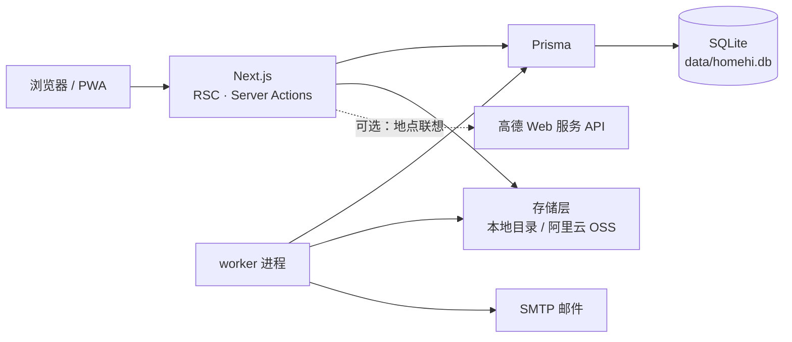

# HomeHi

> 一个只属于你家的生活记录与日常安排空间。Self-hosted. No feed, no strangers, no ads.

[](LICENSE)
[](https://nextjs.org)
[](https://nodejs.org)
[](docker-compose.yml)

HomeHi 是一套可以部署在自己服务器、NAS 或树莓派上的家庭记录系统。它把「今天要做什么」和「我们记住了什么」放在同一个地方：日程、待办、照片、手记、家庭议题、物品清单、旅行打卡，都归在一个家庭空间里，数据存在你自己的磁盘上。

它不追求「社交」和「涨粉」：没有公开主页、没有推荐流、没有第三方统计脚本，也不要求把照片上传到任何人的云空间。一个实例服务一个家庭，成员由家庭管理员直接创建，不需要邀请码、不需要注册入口。

---

## 目录

- [这是什么](#这是什么)
- [功能](#功能)
- [设计原则](#设计原则)
- [技术栈](#技术栈)
- [快速开始](#快速开始)
- [配置](#配置)
- [部署](#部署)
- [数据、权限与备份](#数据权限与备份)
- [媒体处理](#媒体处理)
- [重复规则与提醒](#重复规则与提醒)
- [目录结构](#目录结构)
- [常用脚本](#常用脚本)
- [测试与代码质量](#测试与代码质量)
- [已知边界](#已知边界)
- [参与贡献](#参与贡献)
- [License](#license)

## 这是什么

大多数家庭工具是「给所有人用的」：注册、加好友、公开分享、时间线推荐。HomeHi 的假设相反——你们家的日子只对你们家有价值，也只需要你们家看到。

因此它是一个**单家庭、自托管、默认私有**的应用：

- **数据归你**：SQLite 数据库 + 本地媒体目录（或你自己的 OSS Bucket），一条命令即可完整备份和导出。
- **默认不公开**：所有内容按 `家庭可见 / 仅自己` 控制，媒体文件通过带鉴权的接口读取，静态目录里没有私人照片。
- **长期可读**：没有会员等级、没有云服务依赖，十年后照着 README 仍能把它跑起来。

## 功能

### 记录

| 模块 | 说明 |
| --- | --- |
| 时光 | 瞬间、手记、回顾、日常四种类型，按时间倒序，支持标签、关联家人、可见范围 |
| 照片与相册 | 拖拽上传、EXIF 拍摄时间、相册整理、原图保留，列表走缩略图 |
| 视频 | 自动转码为 H.264 MP4 并生成封面，原文件仍可下载 |
| 那年今天 | 自动找出往年同一天的内容，出现在今日页 |

### 安排

| 模块 | 说明 |
| --- | --- |
| 今日 | 当天日程与待办、接下来几天、最近的生活，一屏看到今天要做什么 |
| 日历 | 月视图、日程与全天事件、公历与农历（可选） |
| 重复日程 | 每天 / 每周 / 每月 / 每年，可设间隔与结束日期 |
| 待办 | 截止时间、优先级、负责人、完成记录 |
| 提醒 | 日程和待办按「提前 N 分钟」生成通知；配置 SMTP 后由 worker 发送邮件 |
| 生日 | 家人与宠物的公历/农历生日提醒 |

### 家人与家庭

| 模块 | 说明 |
| --- | --- |
| 家人与宠物 | 档案、头像、生日、关联账号 |
| 家庭议题 | 需要一起决定的事：想法、意见、链接、附件、相关日期与待办 |
| 物品与资产 | 家里有什么、放在哪、保修到什么时候、值多少钱 |
| 搜索 | 跨瞬间、照片、日程、待办、家人、物品、标签搜索 |

### 旅行

| 模块 | 说明 |
| --- | --- |
| 主题打卡 / 单次旅行 | 长期主题（如「全国博物馆」）或一次性行程 |
| 内置模板 | 全国博物馆、山西古建筑、四大石窟、名山、湖泊、地标，共 6 套，附默认封面与地点清单 |
| 地点 | 高德 Web 服务 API 联想选点并保存坐标；未配置 Key 时直接手填 |
| 打卡 | 每个地点记录到访时间、感受、照片，进度按地点统计 |
| 链接 | 支持攻略网页、微信小程序链接与分享文案；小程序链接以「复制」方式打开 |

### 系统

- **导出**：一键下载 ZIP（`homehi-data.json` + 全部原图/视频 + 议题附件）。
- **回收站**：删除的内容保留，恢复或彻底删除都由你决定。
- **存储后端**：本地目录或阿里云 OSS，可随时切换，历史文件按上传时的后端读取。
- **外观**：暖纸、青瓷、墨白、蜜桃、汽水、夜色、青柠 7 套配色，可跟随系统。
- **PWA**：可添加到手机主屏幕，像 App 一样打开。
- **首次初始化**：访问 `/setup` 创建家庭空间与管理员账号，之后关闭注册入口。

## 设计原则

1. **家庭是权限边界。** 每个查询都带 `householdId`，没有跨家庭的数据路径。
2. **私有是默认值。** 内容默认家庭可见，也可以设为仅自己；列表、详情、搜索、API 都执行同一套可见性判断。
3. **媒体不裸露在静态目录。** `/api/media/*` 校验登录状态与资源权限后才返回文件；缩略图失败时回落到原文件，而不是让照片不可看。
4. **不做无意义的功能。** 没有统计卡片、没有排行榜、没有「活跃度」；首页只回答两个问题：今天要做什么、最近发生了什么。
5. **数据可带走。** 结构化的 JSON、原始媒体文件、可执行的备份脚本，缺一不可。

## 技术栈

- **框架**：Next.js 16（App Router、React Server Components、Server Actions）
- **UI**：React 19 + Tailwind CSS 4，图标使用 lucide-react
- **数据**：Prisma 6 + SQLite，迁移随仓库提交
- **认证**：邮箱 + 密码（bcrypt），JWT 会话存于 HttpOnly Cookie，有效期 30 天
- **媒体**：sharp 生成 WebP 变体，ffmpeg 转码视频并抽帧
- **存储**：本地文件系统或阿里云 OSS
- **后台任务**：独立 `worker` 进程（提醒投递、媒体补处理）
- **测试**：Vitest；类型检查：`tsc --noEmit`



Web 与 worker 共享同一个数据库和存储目录。web 负责页面与上传，worker 负责定时提醒和补齐媒体变体；只跑 web 也能用，但提醒不会发出、批量转码不会进行。

## 快速开始

### Docker（推荐）

```bash
git clone https://github.com/zlcxk/HomeHi.git
cd HomeHi
cp .env.example .env
# 修改 .env 中的 AUTH_SECRET，至少 32 个字符：
#   openssl rand -base64 48
docker compose up -d --build
```

打开 `http://localhost:3000`，按提示在 `/setup` 建立家庭空间。首次启动会自动执行数据库迁移。

`docker-compose.yml` 启动两个容器（web + worker），共享 `./data` 与 `./storage`；`.env` 里的变量会同时注入两者。

### 本地开发

推荐 Node.js 22（与 Docker 镜像一致）。视频转码需要 ffmpeg（系统安装，或依赖 `ffmpeg-static` 的自动回退）。

```bash
npm install
cp .env.example .env        # 修改 AUTH_SECRET
npm run dev:all             # 同时启动 web 与 worker
# 只要页面：npm run dev
```

数据库默认位于 `data/homehi.db`，`npm run dev` 会先执行 `prisma migrate deploy`。

### 第一次使用

1. `/setup` 创建家庭空间、管理员账号和时区。
2. 在「设置 → 家庭」添加成员（由管理员直接创建账号，成员登录后可改密码）。
3. 可选：在「设置 → 数据」载入示例数据，熟悉后再一键清空。
4. 可选：在「设置 → 邮件」配置 SMTP 并发送测试邮件，提醒才会真正发出。

## 配置

配置集中在 `.env`（参考 [`.env.example`](.env.example)）。除 `AUTH_SECRET` 外都有可用默认值。

| 变量 | 必填 | 默认 | 说明 |
| --- | --- | --- | --- |
| `AUTH_SECRET` | **是** | — | 会话签名密钥，至少 32 字符 |
| `DATABASE_URL` | 否 | `file:../data/homehi.db` | SQLite 路径，相对 `prisma/schema.prisma` |
| `NEXT_PUBLIC_APP_URL` | 否 | `http://localhost:3000` | 邮件和绝对链接使用的公开地址 |
| `DEFAULT_TIMEZONE` | 否 | `Asia/Shanghai` | 新空间默认时区（IANA 名称） |
| `COOKIE_SECURE` | 否 | 自动 | 留空时依据 `x-forwarded-proto` 判断，全站 HTTPS 可设 `true` |
| `STORAGE_DRIVER` | 否 | `local` | `local` 或 `oss`；也可在「设置 → 存储」中修改 |
| `STORAGE_DIR` | 否 | `./storage` | 本地媒体目录，Docker 内为 `/app/storage` |
| `MAX_UPLOAD_MB` | 否 | `100` | 单个文件上传上限 |
| `OSS_REGION` / `OSS_BUCKET` / `OSS_ACCESS_KEY_ID` / `OSS_ACCESS_KEY_SECRET` / `OSS_ENDPOINT` / `OSS_PREFIX` | 否 | — | 使用 OSS 时填写 |
| `SMTP_HOST` / `SMTP_PORT` / `SMTP_SECURE` / `SMTP_USER` / `SMTP_PASSWORD` / `SMTP_FROM` | 否 | — | 留空则通知显示「未配置」 |
| `AMAP_API_KEY` | 否 | — | 高德**Web 服务** Key（不是 JS API Key），仅服务端调用 |
| `AMAP_CITY` | 否 | 全国 | 限定地点联想城市，可填城市名或 adcode |
| `WORKER_POLL_SECONDS` | 否 | `30` | worker 轮询间隔 |
| `WORKER_REMINDER_HORIZON_DAYS` | 否 | `180` | 提前生成提醒的天数窗口 |
| `FFMPEG_PATH` | 否 | 自动探测 | 自定义 ffmpeg 路径 |
| `BACKUP_DIR` | 否 | `./backups` | `npm run backup` 的输出目录 |

> 使用阿里云 OSS 时，建议在 RAM 中为 HomeHi 单独创建子账号，只授予目标 Bucket 的读写权限并定期轮换密钥。AccessKey Secret 会以明文保存在数据库中，请限制数据库文件的访问权限。

## 部署

### Docker Compose

```bash
docker compose up -d --build     # 构建并启动
docker compose logs -f web       # 查看日志
docker compose pull && docker compose up -d --build   # 更新
```

- 数据卷：`./data`（SQLite）、`./storage`（本地媒体）。升级前备份这两个目录。
- 健康检查：`GET /api/health`。
- 反向代理：把 `NEXT_PUBLIC_APP_URL` 设为公开域名，并确保代理传递 `X-Forwarded-Proto`（HTTPS 时 `COOKIE_SECURE` 会自动启用）。

### 不走 Docker

```bash
npm ci
npm run build
npm run start        # web，包含迁移
npm run worker:prod  # 另开进程
```

生产环境必须让 worker 常驻，否则提醒不会发出、批量媒体处理不会进行。进程管理交给 systemd、supervisor 或进程管理器即可。

## 数据、权限与备份

### 可见性

- 每个条目、日程、待办、媒体、家人档案、旅行都有 `HOUSEHOLD`（家庭可见）或 `PRIVATE`（仅自己）两种可见性。
- 列表、详情、搜索、导出和 API 使用同一套条件（`householdId` + 可见性），不存在「列表看不到但直链能打开」的路径。
- 媒体接口 `/api/media/[id]/{thumb,display,playback,file}` 在返回文件前重新校验资源归属与可见性；私人媒体的存储目录不通过静态资源暴露。

### 导出与备份

| 方式 | 用途 |
| --- | --- |
| 设置 → 数据 → 导出 | 下载 `homehi-export-YYYY-MM-DD.zip`：`homehi-data.json`（完整结构化数据）、`media/`（原图与视频）、`topics/`（议题附件） |
| `npm run backup` | 复制数据库与本地媒体到 `backups/homehi-<时间戳>/`，数据库用 `VACUUM INTO` 生成一致性快照 |
| 存储后端快照 | 使用 OSS 时，媒体请依赖 OSS 的版本控制或跨区域复制 |

备份只是复制，恢复需要手动把 `homehi.db` 和媒体目录放回 `data/`、`storage/`。建议在 cron 中每天执行一次备份，并把备份目录同步到另一块磁盘或对象存储。

## 媒体处理

上传响应立即返回，尺寸变体随后补齐：图片缩略图由 web 在后台生成，预览图在首次访问 `/api/media/[id]/display` 时生成；视频先由客户端抓一帧作封面，播放版由 worker 转码，失败的变体由 worker 定期重试。生成规则：

| 类型 | 规格 |
| --- | --- |
| 列表缩略图 | 长边 480px，WebP，质量 80 |
| 详情预览图 | 长边 960px，WebP，质量 80 |
| 视频封面 | 长边 720px，WebP |
| 视频播放版 | H.264 / AAC MP4，长边不超过 1280px |

- 原文件始终保留，`/api/media/[id]/file` 提供原图/原视频下载。
- 缩略图或转码失败时，页面回落到原文件，**不会因为处理失败导致媒体无法查看或下载**。
- 缩略图版本号（`THUMB_VERSION`）变更后，旧图会在下次读取或 worker 巡检时按新规格重建，不需要重新上传。
- 历史数据可批量补齐：

```bash
npm run media:backfill -- --type=all --retry-failed
npm run media:backfill -- --type=video --limit=20
```

## 重复规则与提醒

- 重复日程支持 `NONE / DAILY / WEEKLY / MONTHLY / YEARLY`，可设置间隔与结束日期；系统按家庭时区展开具体发生时间，夏令时跳变不会漂移。
- 提醒规则保存「提前多少分钟」的数组，日程或待办变化时重新计算。
- worker 每 30 秒轮询到期通知，最多尝试 5 次，重试间隔为 5 / 15 / 45 / 120 分钟；超过上限标记为失败，可在通知页查看。
- 未配置 SMTP 时，通知会明确显示「未配置」，而不是静默失败。

## 目录结构

```
app/
  (app)/            登录后的主界面：today、timeline、calendar、photos、tasks、
                    topics、assets、profiles、travel、settings、search、trash …
  (focus)/          专注编辑页：compose/*、*/edit
  api/              media、entries、export、geo（高德联想）、health、topic-attachments
  login/ setup/     登录与首次初始化
components/         界面组件（entries、pickers、travel、photos …）
lib/                领域逻辑：auth、access、media、video、recurrence、reminders、
                    travel、amap、storage、validation …
prisma/             schema、迁移、种子入口
scripts/            worker、backfill、backup、seed、ensure-dirs
tests/              Vitest 单元测试
docs/               产品评审记录与功能说明
public/travel/      内置旅行主题封面
```

## 常用脚本

| 命令 | 说明 |
| --- | --- |
| `npm run dev` / `npm run dev:all` | 开发服务器 / 同时启动 worker |
| `npm run build` / `npm run start` | 生产构建 / 生产启动（含迁移） |
| `npm run worker` / `npm run worker:prod` | 开发 / 生产运行 worker |
| `npm run media:backfill` | 补齐缺失或过期的媒体变体 |
| `npm run backup` | 备份数据库与本地媒体 |
| `npm run db:migrate` / `db:deploy` / `db:studio` / `db:reset` | 迁移与数据库工具 |
| `npm run seed` | 载入示例数据 |
| `npm test` / `npm run test:watch` | 单元测试 |
| `npm run typecheck` | TypeScript 类型检查 |

## 测试与代码质量

```bash
npm run typecheck && npm test
```

测试覆盖链接规范化（含小程序链接与危险协议拦截）、坐标解析、重复规则、日期与农历、媒体路径、旅行模板完整性等纯逻辑部分。改动数据层或权限逻辑时，请先跑通类型检查与测试。

## 已知边界

- **一个实例 = 一个家庭。** 初始化后不再开放注册，成员由管理员创建；多家庭部署需要多个实例。
- **SQLite + 单节点。** 适合家庭规模（几个成员、几万张照片）。不支持多实例水平扩展；大规模场景请自行替换为 PostgreSQL。
- **提醒依赖 worker 与 SMTP。** 没有常驻 worker 或没有配置邮件，提醒不会送达；目前没有站内推送或第三方推送通道。
- **视频转码需要 ffmpeg。** 缺失时视频仍可上传与播放原文件，但没有封面与压缩版。
- **没有原生 App。** 以 PWA 方式安装到主屏幕；iOS 的部分后台能力受系统限制。

## 参与贡献

欢迎 issue 和 pull request。提交前请：

1. 描述问题或需求，较大的改动先开 issue 讨论，避免白做。
2. 保持改动聚焦，不要顺手重构无关模块。
3. 运行 `npm run typecheck && npm test`，必要时补充测试。
4. 界面文案沿用现有中文风格；涉及权限、媒体、隐私的改动请在 PR 中说明影响。

发现安全问题请不要公开提交 issue，通过 GitHub 私下联系维护者 [@zlcxk](https://github.com/zlcxk)。

## License

[MIT](LICENSE) © HomeHi contributors

可自由使用、修改和分发，包括商业用途；请保留版权声明。如果你希望采用 AGPL 等更严格的开源协议，可以替换仓库根目录的 `LICENSE` 文件。
